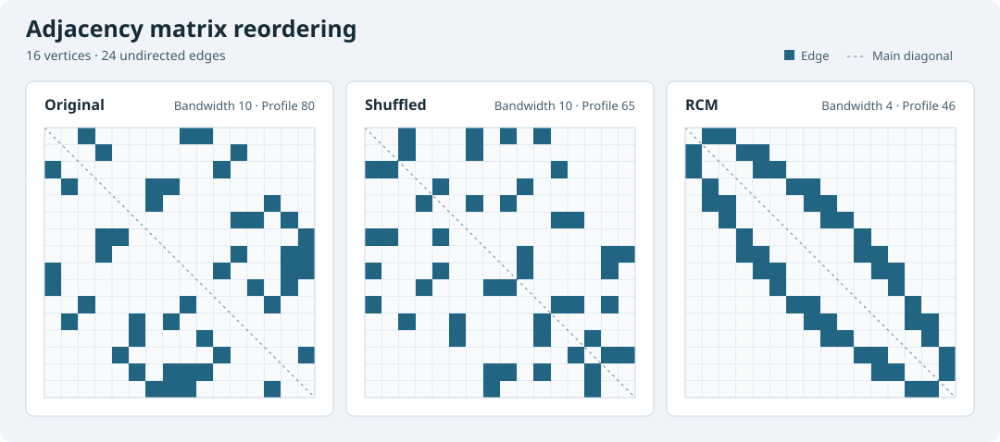

# rcm-sparse-bandwidth

A Rust CLI for exploring how Reverse Cuthill–McKee (RCM) changes the bandwidth
and lower profile of a sparse adjacency matrix. It supports simple undirected
graphs with 5–200 vertices, including disconnected components and isolated vertices.



## Run the experiments

```sh
cargo run --locked --release -- analyze --input examples/scrambled-path.json
cargo run --locked --release -- trace --input examples/disconnected.json
cargo run --locked --release -- verify --graphs 1000 --seed 42
cargo run --locked --release -- benchmark --vertices 25,50,100,200 --trials 100 --seed 42
cargo run --locked --release -- render --input examples/scrambled-grid.json --output artifacts/rcm-comparison.svg
```

`analyze` compares the input order, one seeded shuffle, and RCM. `trace` shows
component roots, queue pops, newly enqueued neighbors, and both the CM and RCM
orders. `render` writes the three heatmaps at the same scale. The default seed
is `42` for every command that uses randomness.

| Input | Original bandwidth / profile | RCM bandwidth / profile |
| --- | ---: | ---: |
| [Scrambled six-vertex path](examples/scrambled-path.json) | 3 / 9 | 1 / 5 |
| [Scrambled 4×4 grid](examples/scrambled-grid.json) | 10 / 80 | 4 / 46 |
| [Disconnected paths with an isolate](examples/disconnected.json) | 4 / 12 | 1 / 4 |
| [Five-vertex star](examples/star-counterexample.json) | 2 / 5 | 3 / 4 |

The grid's natural row-major order has bandwidth 4 and profile 51. The star
shows a tradeoff that can occur with the heuristic. Its profile improves while
its bandwidth increases.

Regenerate the README image with the same input and seed.

```sh
cargo run --locked --release -- render --input examples/scrambled-grid.json --seed 42 --output docs/images/scrambled-grid.svg
```

## Input and permutation

```json
{
  "vertices": [1, 4, 2, 5, 3, 6],
  "edges": [[1, 2], [2, 3], [3, 4], [4, 5], [5, 6]]
}
```

The `vertices` array defines the original matrix order. Use unique unsigned
32-bit IDs and include every vertex, even those with no edges. List each edge
once in either direction. Unknown endpoints, self-loops, and duplicate edges
are input errors.

RCM runs breadth-first search from the lowest-degree unvisited vertex and
enqueues each popped vertex's unvisited neighbors in degree order. Vertex ID
breaks ties for both roots and neighbors. Once all components have been visited,
the algorithm reverses the entire CM order. For `p[new] = old`, the reordered
matrix satisfies `B[i,j] = A[p[i],p[j]]`. The sparse permutation builds the
inverse and remaps every edge to its new row and column indices.

Bandwidth is the maximum `|i - j|` over occupied cells and is zero for an edgeless
graph. Lower profile sums `i - j_min` for each row `i`, where `j_min` is the
leftmost occupied column or the diagonal when the row has no entry to its left.
Reversing CM preserves the distance `|i - j|` for every edge and can change the
lower profile.

## Verification and benchmark

`verify` generates seeded graphs with varied sizes and densities. It checks that
the permutation and its inverse are bijective, recovers the exact edge set,
checks each permuted matrix entry, and verifies `B(Px) = P(Ax)` with integer
vectors. It prints the graph as JSON if an invariant fails.

`benchmark` generates one graph per size by sampling `2n` unique edges
uniformly, then shuffles that graph's vertex order repeatedly. It reports
minimum, median, and maximum metrics for the shuffles and counts how often RCM
is lower, equal, or higher. It also reports BFS operations and median times in
microseconds for ordering and permutation. Ordering time includes degree
sorting. Permutation time includes validating the order, constructing the
inverse, and rebuilding the sparse graph. The timers exclude graph generation,
metric calculation, printing, and rendering.

For an optional external comparison, give SciPy the symmetric CSR adjacency
matrix and use `reverse_cuthill_mckee(A, symmetric_mode=True)`. Compare the
metrics and invariants for the resulting order, allowing for different root and
tie-breaking policies. [SciPy RCM reference](https://docs.scipy.org/doc/scipy/reference/generated/scipy.sparse.csgraph.reverse_cuthill_mckee.html)

```sh
cargo fmt --all --check
cargo clippy --locked --all-targets -- -D warnings
cargo test --locked
```
